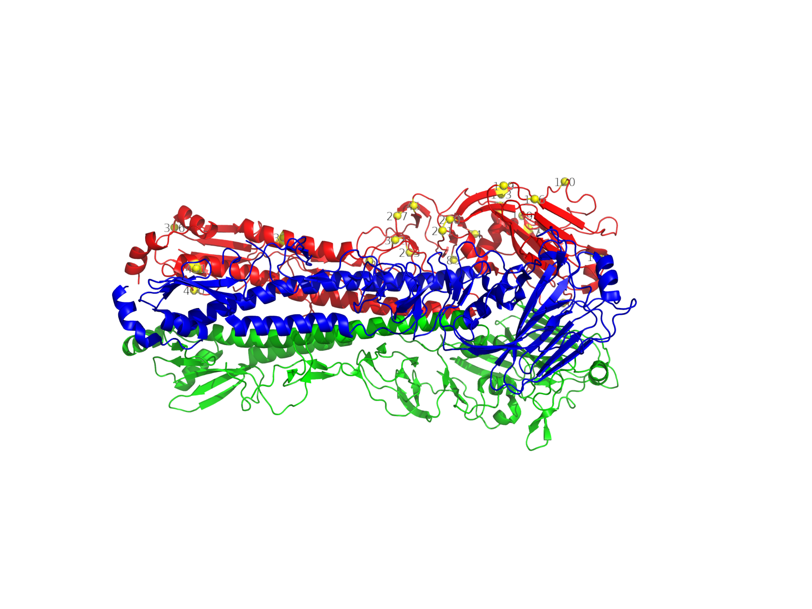
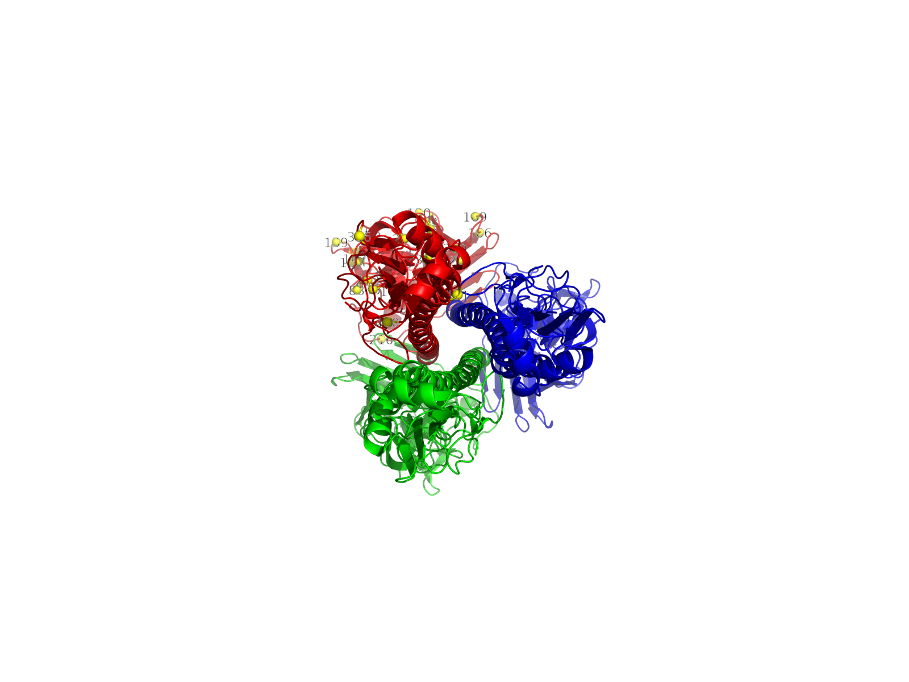
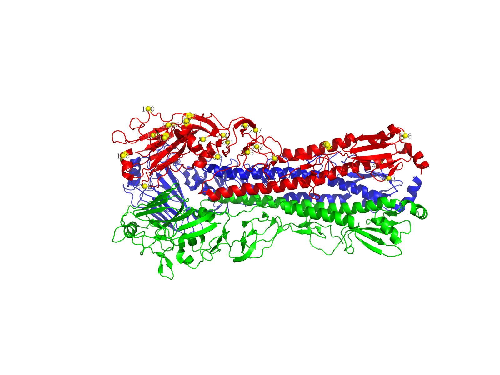
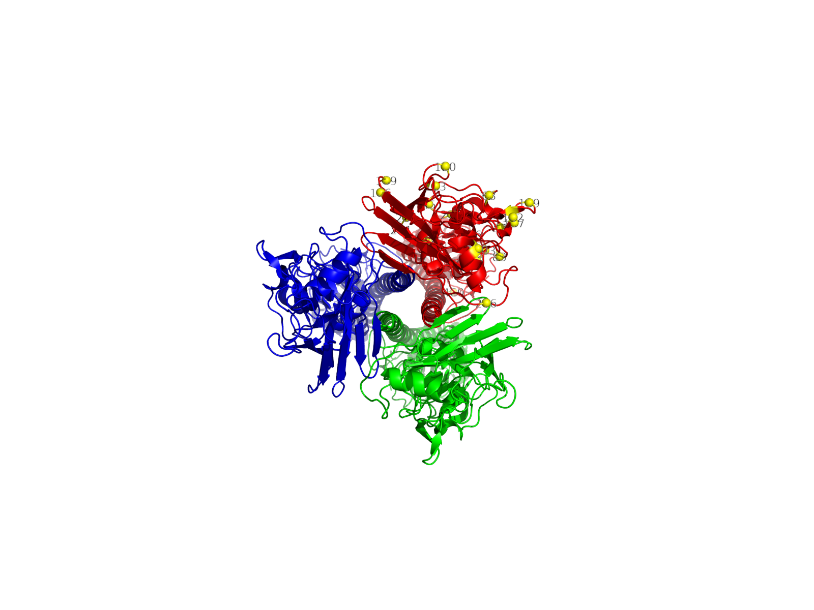

These views map the current 2024–25 sequence-drift results onto the 7KNA HA
structure. Yellow spheres mark the 23 non-zero drift positions with modeled
coordinates in chain A. Labels show mature HA positions; the structure mapping
translates them to PDB residue numbers. Chains A, B, and C are colored red,
green, and blue.

::: {layout-ncol=2}

{fig-alt="HA trimer with chains A, B, and C colored red, green, and blue; mapped 2024–25 drift positions on chain A are yellow and labeled by mature position." fig-cap="View 1"}

{fig-alt="Rotated view of the HA trimer with mapped 2024–25 drift positions highlighted in yellow." fig-cap="View 2"}

{fig-alt="Rotated view of the HA trimer with mapped 2024–25 drift positions highlighted in yellow." fig-cap="View 3"}

{fig-alt="Rotated view of the HA trimer with mapped 2024–25 drift positions highlighted in yellow." fig-cap="View 4"}

:::

The three above-threshold positions that are not modeled in chain A are omitted
from the views. 7KNA is a related H1 structural scaffold, not the Missouri
reference structure, so these images show mapped sequence positions in a
related structure and do not establish antigenic effects or epitope locations.

Regenerate the images locally from the current workflow outputs with:

```bash
python3 scripts/07_make_pymol_figures.py --season 2024_25
pymol figures/2024_25_structure_views.pml
```
